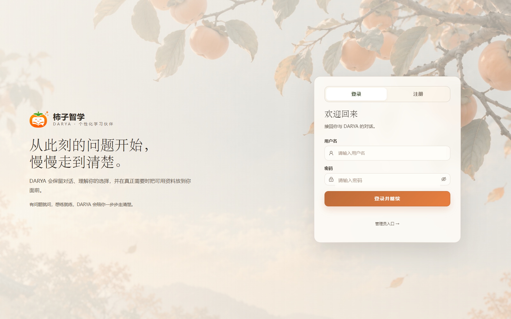
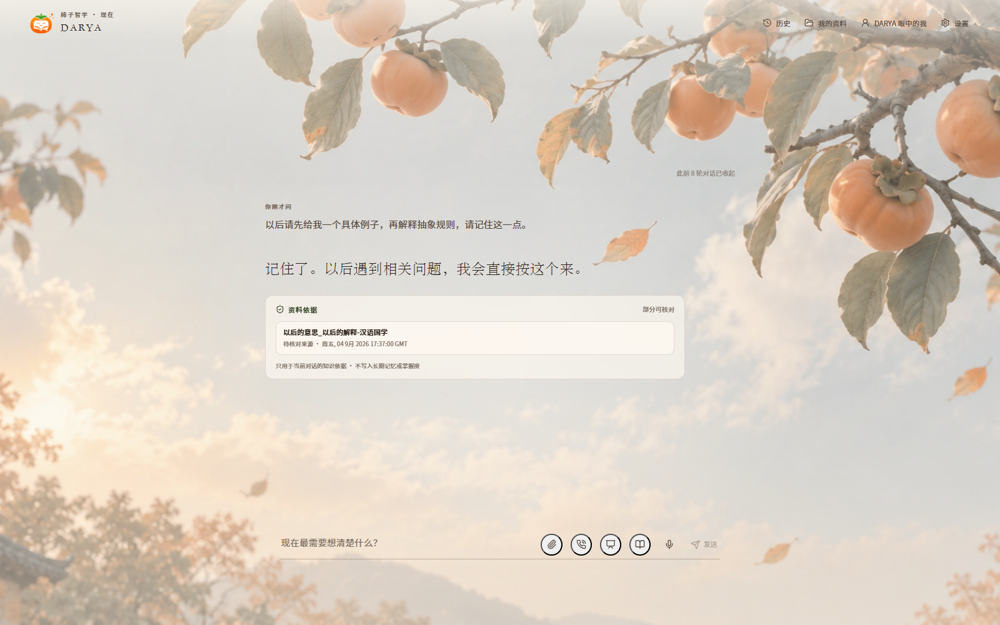
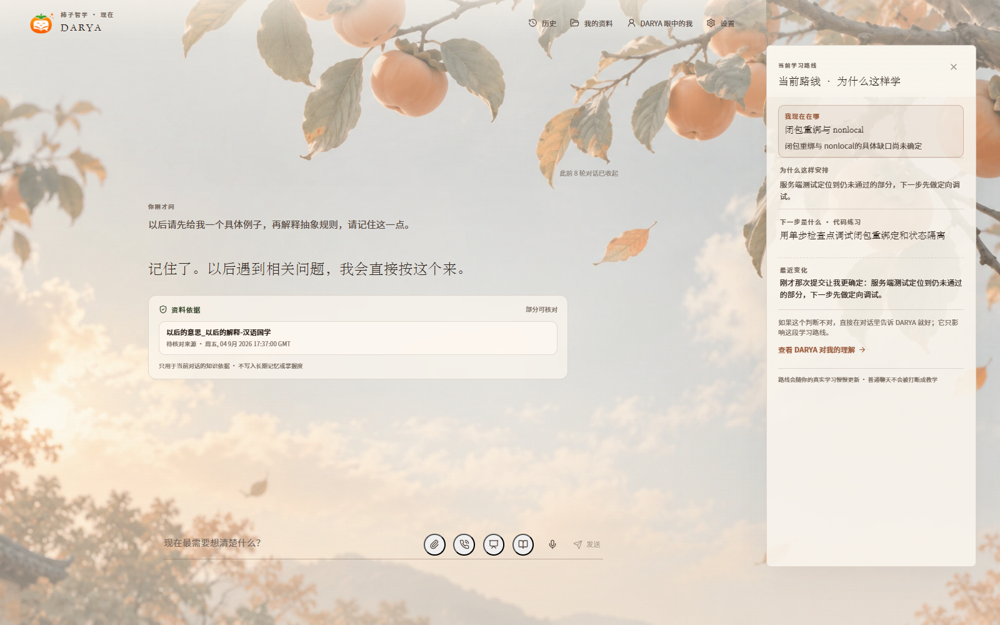
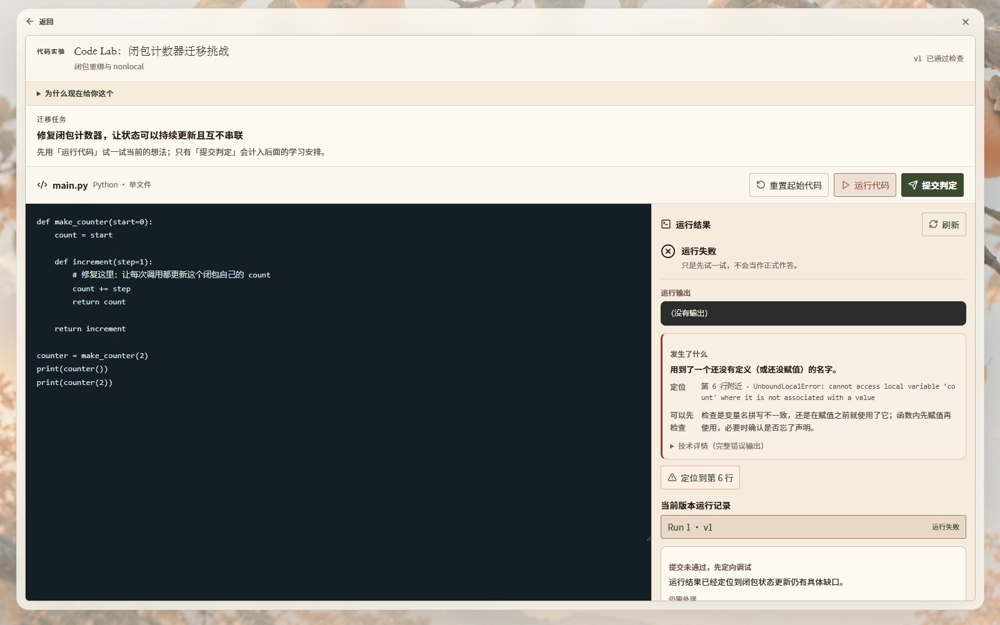
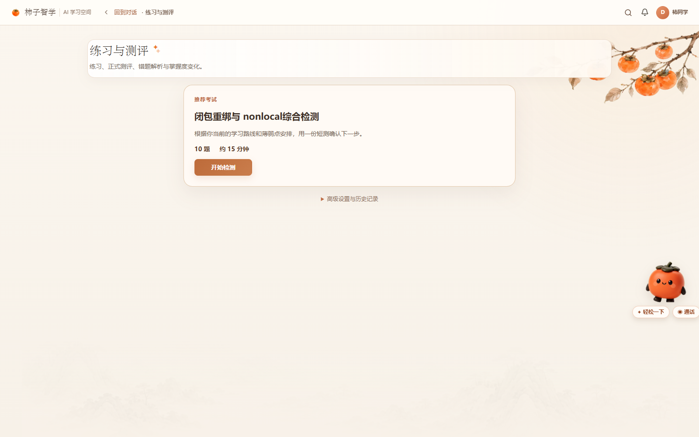
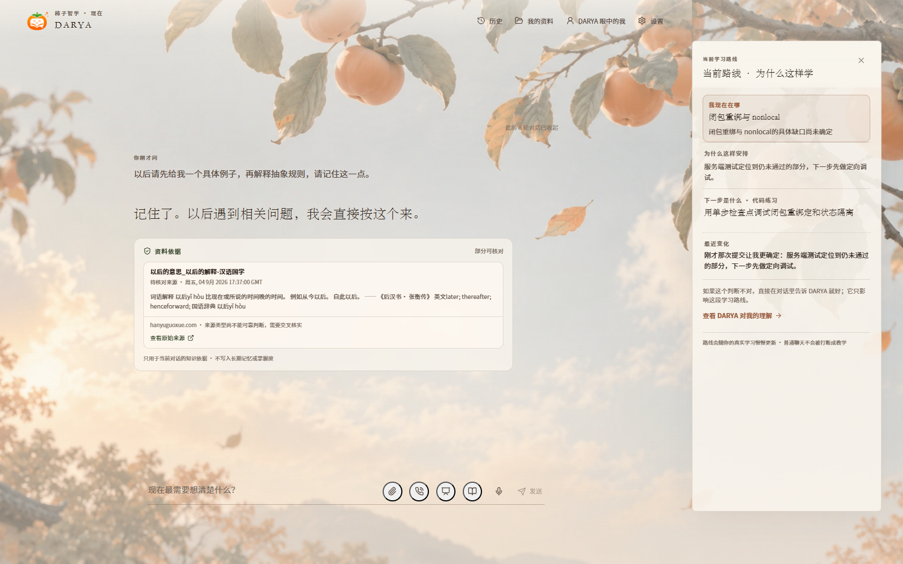

# 柿子智学 · KAKI Learning AI 学习平台

> AI 驱动的个性化学习系统：对话式学习 + 自适应学习路线 + 沉浸式冒险游戏化 + 教学视频生成 + 完整管理后台。

一个**全栈 AI 学习产品**：学生端以"对话式学习 + 个性化学习路线"为核心，内置沉浸式冒险学习游戏、画图对话、教学视频生成等能力；管理端提供完整的用户/学习/内容/系统运营视图。前端 React (Vite + TypeScript + Ant Design)，后端 FastAPI (Python)，深度集成 DeepSeek 等 LLM 与本地 ASR/语音能力。

---

## ✨ 核心功能

| 模块 | 说明 |
|---|---|
| 🧠 AI 对话学习 | 基于大模型的多轮对话辅导，支持上传资料、OCR、语音输入 |
| 🗺️ 个性化学习路线 | 依据学习状态动态规划路线，证据驱动调整（"为什么这样学"） |
| 🎮 沉浸式冒险学习 | 场景化游戏机制：动态地点、自由选路、答错补救、Boss 挑战、奖励与结算 |
| 🖼️ 画图对话学习 | 注册画像引导 + 绘本式学习对话 |
| 🎬 教学视频生成 | 云端视频生成（文生视频），代码实验室 |
| 📊 管理后台 | 用户管理、学习质量、任务下发、公告、系统状态与审计（学生/管理双主题） |
| 🔍 搜索与证据 | 学习资料检索，回答附「资料依据」卡片，引用来源可溯 |
| 🎨 双主题 | KAKI（柿子暖纸）与 Ocean（海岸蓝灰）两套视觉体系 |

## 🖼️ 界面预览

| 登录页 | AI 对话主界面 |
|---|---|
|  |  |

| 学习路线 | 学习资料/产物 |
|---|---|
|  |  |

| 练习与测评 | 搜索与证据 |
|---|---|
|  |  |

> 截图来自真实运行的本地系统（真实登录、真实会话、真实学习状态），非静态稿。

## 🛠️ 技术栈

**前端** `frontend/`
- React 18 + TypeScript + Vite 6
- Ant Design 5 + Zustand + React Router
- ECharts / KaTeX / Markdown 渲染 / mermaid 可视化

**后端** `backend/`
- FastAPI (Python 3.11) + SQLAlchemy (aiosqlite)
- LLM 接入：DeepSeek（主）/ OpenAI 兼容平台（可选），运行时可切换
- 本地 ASR：faster-whisper（无需云密钥）；云端视频生成
- 认证：JWT；RBAC 管理端权限

## 🏗️ 架构

```
frontend/  React SPA (Vite dev :5174 / 生产由后端托管)
backend/   FastAPI (uvicorn :8001)
   ├── routers/       API 路由（chat / learning / admin / darya…）
   ├── services/      AI 编排、学习路线、游戏状态机、内容生成
   ├── agents/        AI 智能体（对话、评估、教学）
   ├── integrations/  LLM / 视频 / 检索 接入层
   └── database/      模型与连接（SQLite，启动自动建表 + 种子管理员）
```

开发模式：`start.ps1`（Vite :5174 + 后端 :8001）
生产模式：`start-prod.ps1`（单端口，后端直接托管前端构建产物，仅需 Python 3.11）

## 🚀 快速启动

```powershell
# 环境：Windows 10/11，Python 3.11，Node.js 20+
.\bootstrap.ps1        # 首次：创建虚拟环境 + 安装前后端依赖
Copy-Item .env.example .env   # 填写 LLM key 与 SECRET_KEY
.\start.ps1            # 启动开发模式，自动打开 http://127.0.0.1:5174/
```

> 本项目不携带任何密钥/凭据。首次启动会自动创建 SQLite 数据库与种子管理员（`INITIAL_ADMIN_*` 配置于 `.env`）。

## 📁 目录结构

```
kaki-learning-ai/
├── backend/          FastAPI 后端（routers / services / agents / integrations / database）
├── frontend/         React 前端（src / public，public 内含 AI 工作区美术资源）
├── scripts/          辅助脚本
└── screenshots/      真实界面截图
```

## ⚠️ 说明

- 本仓库为**展示用途**：仅包含可构建的核心源码与演示截图，不含用户数据、密钥、测试夹具与交付证据。
- AI 功能需自行配置模型 API Key（见 `.env.example`）；未配置时系统可进入演示模式。

## 📄 License

MIT
